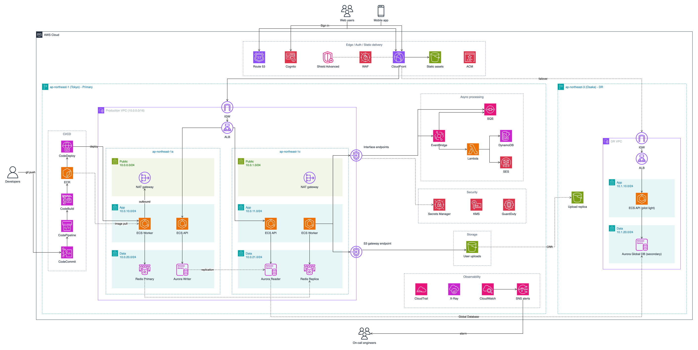
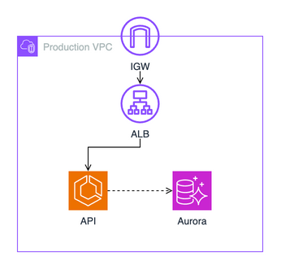
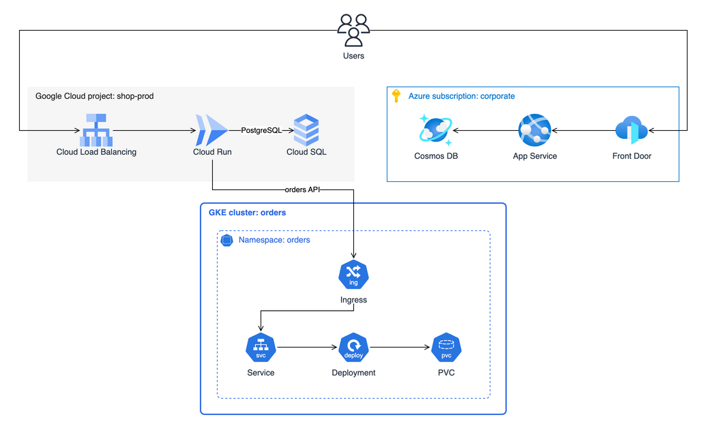

# yaml2drawio

[English](README.md) | **日本語**

[](https://github.com/hiromu-kon/yaml2drawio/actions/workflows/ci.yml)
[](https://www.npmjs.com/package/yaml2drawio)
[](LICENSE)

**インフラ構成図をコードで書き、編集できる draw.io のファイルとして出力する。**

yaml2drawio は、YAML で書いたインフラの構成から、配置を計算した [draw.io](https://www.drawio.com/) の図を作ります。
書くのは構造（何の中に何があるか、どの順に並べるか、何と何がつながっているか）だけで、座標はすべて yaml2drawio が計算します。



<sub>[examples/ecommerce.yaml](examples/ecommerce.yaml) から生成し、draw.io で PNG にしたものです。</sub>

> [!NOTE]
> 初期リリース（0.x）です。マイナーバージョンの間で YAML の書き方が変わる可能性があります。

yaml2drawio は図を描くだけです。クラウドのリソースを読み取ったり変更したりはしません。

## なぜ作るのか

- **手作業や AI で描いた図は崩れやすい。** 作り直すたびに配置が変わり、アイコンが間違い、線がラベルに重なります。
- **図をコードで書くツールの多くは画像を出力する。** PNG や SVG になるので、draw.io で細かく直したり、チームで編集し続けたりできません。

yaml2drawio は、図を読みやすいテキストとしてバージョン管理しつつ、draw.io でそのまま開ける `.drawio` ファイルを出力します。

## 特徴

- **座標ではなく構造を書く**
  入れ子・並び順・向きで配置が決まるので、同じ YAML からは毎回同じ図ができます。
- **draw.io 公式の図形を使う**
  アイコンは draw.io の図形ライブラリから抜き出した辞書（アイコン約 1,900 個。AWS 930 個、Google Cloud 143 個、Azure 701 個、Kubernetes 78 個と、AWS のグループ 20 種）から選びます。draw.io にない Google Cloud・Azure・Kubernetes の枠（プロジェクト、VNet、名前空間など 15 種）は、各社の図に合わせて用意しています。辞書にない名前は推測せず、候補を添えてエラーにします。どのライブラリにもない SaaS などは、手元の SVG や PNG のファイルで描けます。
- **編集できる出力**
  出力は `.drawio` ファイルなので、draw.io や VS Code の拡張機能でそのまま開けます。
- **AI エージェントでも扱いやすい**
  短く書ける YAML と厳密な検証により、エージェントが図を書き、確かめ、推測せずに直せます。
- **複数のクラウドとオンプレミスに対応**
  AWS・Google Cloud・Azure・Kubernetes のアイコン（`aws.ecs`、`gcp.cloud_run`、`azure.aks`、`k8s.pod`）に加えて、クラウドに依存しない汎用アイコン（`general.server`）とオンプレミスの機器（`network.switch`）があります。1 枚の図で、複数のクラウドやデータセンターにまたがる構成を描けます。

## 使い方

Node.js 24 以上が必要です。PNG を出力するには [draw.io Desktop](https://www.drawio.com/) も必要です。

```sh
npx yaml2drawio guide                       # YAML の書き方を表示する
npx yaml2drawio build diagram.yaml          # diagram.drawio を出力する
npx yaml2drawio build diagram.yaml --png    # draw.io Desktop で diagram.png も出力する
npx yaml2drawio build diagram.yaml -o docs/architecture.drawio
npx yaml2drawio build diagram.yaml --strict # 警告があれば終了コード 1 で終わる
npx yaml2drawio icons redis                 # アイコン名を検索する
```

エラーは直す場所の行と列を示します（例: `diagram.yaml:4:15: unknown key "icn" (did you mean "icon"?)`）。
線がアイコンやラベルの上を通りそうなときは、その線の行に警告を出します（例: `diagram.yaml:21:5: warning: link api.s -> db.n crosses the label of "Data 10.0.20.0/24"`）。ファイルはそのまま出力します。`--strict` を付けると終了コードが 1 になるので、CI や AI エージェントは警告が消えるまで直せます。折れ点の間の経路は draw.io が決めるため、その経路を予測して調べており、見逃すこともあります。
draw.io Desktop が見つからない場合は、環境変数 `DRAWIO_CLI` に実行ファイルのパスを設定してください。

### AI エージェントに描かせる

`yaml2drawio guide` は、YAML の書き方・作業の流れ・きれいに配置するコツを Markdown で表示します（[docs/guide.md](docs/guide.md)、英語）。yaml2drawio を知らないエージェントでも、CLI から使い方を覚えられます。たとえば次のように頼みます。

> `infra/` の Terraform から AWS の構成図を `npx yaml2drawio` で描いて。先に `npx yaml2drawio guide` を読んで。

書き方より先のこと（Terraform・CloudFormation・CDK・実際のアカウントの読み取り方、何を省くか、複数のクラウドにまたがる図）まで任せるなら、エージェント用のスキルを入れてください。Claude Code・Codex・Cursor など、[Agent Skills](https://agentskills.io/) に対応したエージェントで使えます。

```sh
npx skills add hiromu-kon/yaml2drawio
```

## 書き方の例

```yaml
direction: vertical
nodes:
  - group: aws.vpc
    label: Production VPC
    direction: vertical
    border:
      n: { id: igw, icon: aws.igw, label: IGW }
    children:
      - { id: alb, icon: aws.alb, label: ALB }
      - row:
          - { id: api, icon: aws.ecs, label: API }
          - { id: db, icon: aws.aurora, label: Aurora }
links:
  - [igw.s, alb.n]
  - [alb.s, api.n]
  - { from: api.e, to: db.w, style: dashed }
```



### 複数のクラウドにまたがる例



<sub>[examples/multi-cloud.yaml](examples/multi-cloud.yaml) から生成したものです。クラウドごとに draw.io のレイヤーを分けているので、draw.io でクラウドごとに表示・非表示を切り替えられます。</sub>

ほかの例は、図つきで [examples/](examples/README.ja.md) にあります。

### エディタでの補完

YAML ファイルの先頭で JSON Schema を指定すると、キー・アイコン名・グループ名を補完でき、図を作る前に書き間違いに気づけます。VS Code では [YAML 拡張機能](https://marketplace.visualstudio.com/items?itemName=redhat.vscode-yaml)が必要です。

```yaml
# yaml-language-server: $schema=https://raw.githubusercontent.com/hiromu-kon/yaml2drawio/main/schema.json
```

## 他のツールとの比較

|                    | yaml2drawio                          | [awsdac](https://github.com/awslabs/diagram-as-code) | [Diagrams](https://github.com/mingrammer/diagrams) | [D2](https://github.com/terrastruct/d2) |
| ------------------ | ------------------------------------ | ---------------------------------------------------- | -------------------------------------------------- | --------------------------------------- |
| 入力               | YAML                                 | YAML                                                 | Python                                             | D2 言語                                 |
| 出力               | `.drawio`（編集できる）              | PNG                                                  | PNG、JPG、SVG、PDF、DOT                            | SVG、PNG、GIF、PDF、PPTX                |
| 配置               | 入れ子と並び順から計算               | 入れ子と並び順から計算                               | Graphviz                                           | Dagre、ELK、TALA から選ぶ               |
| クラウドのアイコン | AWS、Google Cloud、Azure、Kubernetes | AWS（定義ファイルで追加できる）                      | AWS、Azure、GCP、Kubernetes など                   | 任意の画像                              |

## 開発に参加する

[CONTRIBUTING.md](CONTRIBUTING.md)（英語）を参照してください。

## ライセンス

[MIT](LICENSE)

アイコンは draw.io のサイドバー定義（[jgraph/drawio](https://github.com/jgraph/drawio)）から抜き出しています。draw.io のソースコードは Apache-2.0 ですが、アイコンとステンシルには、許可なく Atlassian の製品やプラグインに使うことを禁じる[追加の条件](https://github.com/jgraph/drawio#license)があります。
yaml2drawio は draw.io Ltd や draw.io AG とは関係のない非公式のツールで、両社の推薦も受けていません。
