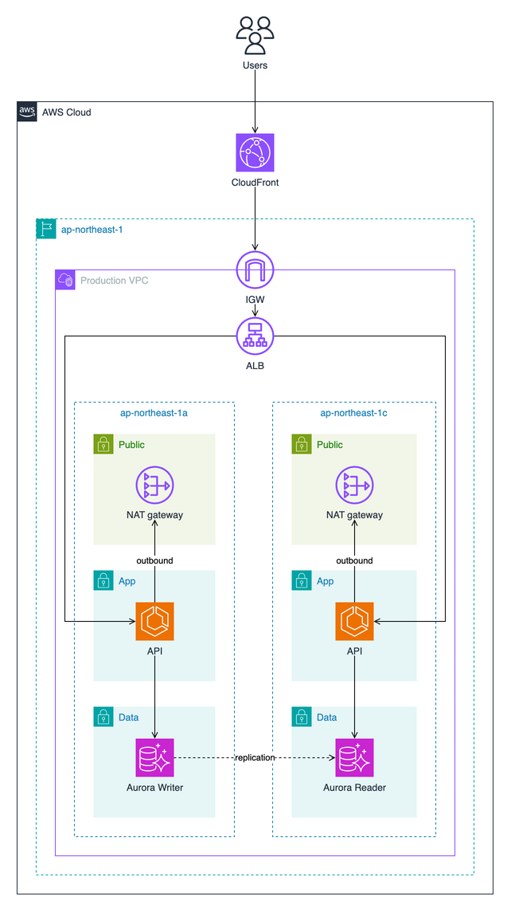
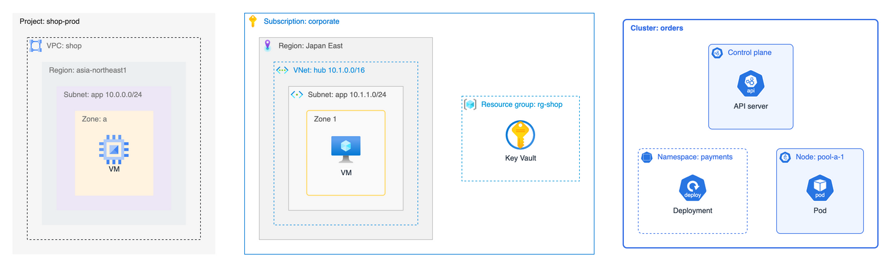

# Examples

**English** | [日本語](README.ja.md)

Each diagram below is generated from the YAML file next to it with `yaml2drawio build` and rendered with draw.io.
Click an image to see it full size, or open the `.drawio` file in draw.io to edit it.

## Quick start

A VPC with an internet gateway on its border, a load balancer, and a row with an API and its database.

[quick-start.yaml](quick-start.yaml) · [quick-start.drawio](../docs/images/quick-start.drawio)

## Web application

A region with two availability zones, each with public, app and data subnets, and lines that run straight down through them.

[web-app.yaml](web-app.yaml) · [web-app.drawio](../docs/images/web-app.drawio)

## E-commerce platform

A primary region in Tokyo and a disaster recovery region in Osaka, with services outside the VPC, empty slots that line up rows of different lengths, and labels on lines.

[ecommerce.yaml](ecommerce.yaml) · [ecommerce.drawio](../docs/images/ecommerce.drawio)

## Multi-cloud

Google Cloud, Azure and a GKE cluster in one diagram, each on its own draw.io layer so it can be shown or hidden on its own.

[multi-cloud.yaml](multi-cloud.yaml) · [multi-cloud.drawio](../docs/images/multi-cloud.drawio)

## Provider groups

The groups for Google Cloud, Azure and Kubernetes, such as projects, subscriptions, VNets, namespaces and nodes, nested the way each provider draws them.

[provider-groups.yaml](provider-groups.yaml) · [provider-groups.drawio](../docs/images/provider-groups.drawio)
